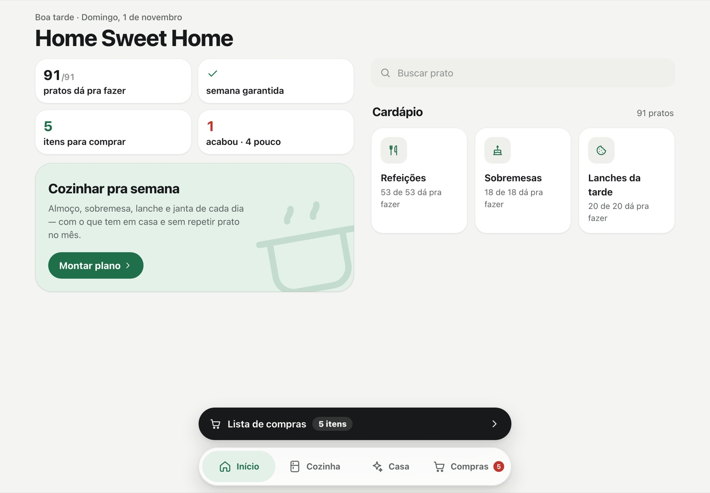
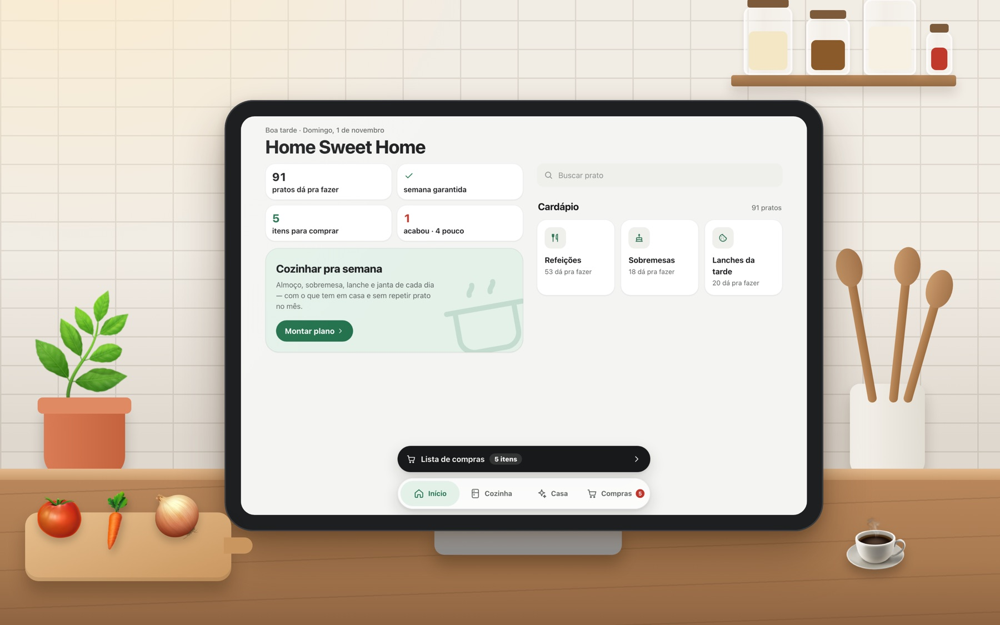

# Home Sweet Home 🏡

**English** · [Português](README.pt-BR.md)

An open-source, self-hosted kitchen and household assistant. Keep track of what you have at
home, plan a week of home-cooked meals from it, and turn what's missing into a shopping list.

[](LICENSE)




Built to stay open on a tablet in the kitchen. It also works on phones and desktops, and can
be installed as an app from the browser. The interface and the bundled recipes are in
Brazilian Portuguese (home-style Brazilian food).

> Vibe-coded as a personal project, shared so anyone can run it, adapt it and add their own
> recipes.

## Features

- **Pantry and home supplies.** Track items by generic name ("Rice", "Milk", not the brand)
  with three states: *have*, *running low*, *out*. Food, cleaning, tools and toiletries.
- **What can I cook?** See which dishes you can make with what's at home.
- **Weekly meal plan.** Pick how many days and desserts; the planner picks dishes, spreads them
  across lunch, dinner, dessert and snack, and writes a cooking-day schedule with times.
- **Shopping list.** One list grouped by category. Share it (WhatsApp or any app) and tap
  *Bought* to put everything back in stock.
- **Weekly alert.** Tells you what's missing to have a full week of food.
- **Variety.** No main dish or dessert repeats within a month.

## Usage

Leave it open on a tablet on the counter: check today's meals, mark what ran out and build the
list without leaving the kitchen.



| Tab | What it does |
|---|---|
| 🏠 **Início** (Home) | Key numbers (dishes you can make, week covered, items to buy, items out), weekly alert, **Today** card and the menu. |
| 🧺 **Cozinha** (Kitchen) | Status chips (*out · low · on the list*) that filter the grid; categories as blocks. Tap an item to go *have* → *low* → *out*; the pencil edits it. |
| 🧽 **Casa** (Home supplies) | Same for cleaning, tools and toiletries. |
| 🛒 **Compras** (Shopping) | The shopping list plus **Recently bought**, one tap to add back. |

## Quick start

Requires only Python 3 (SQLite is built in).

```bash
git clone https://github.com/hi-mundo/HomeSweetHome.git
cd HomeSweetHome
python3 server.py
```

Open `http://localhost:8080`. From a phone or tablet on the same Wi-Fi, open
`http://<this-computer-ip>:8080` and use **Add to Home Screen** to install it.

| Setting | Default |
|---|---|
| `PORT` | `8080` |
| `LAR_DB` | `data/lar.db` (created on first run with common items) |

```bash
PORT=9000 python3 server.py
```

To keep it running (Raspberry Pi, home server) with systemd or nginx, see
[DEPLOY.md](DEPLOY.md).

## Add your own dishes

Everything the app knows about food lives in plain JSON in [`pratos/`](pratos/): the item
catalog, the base preparations ("pots") and the dishes built from them. The app reloads the
folder by itself, no restart needed, and shows format errors on the home screen.

The format is documented in [`pratos/LEIA-ME.md`](pratos/LEIA-ME.md). Tip: new dishes that
reuse existing pots make for less work on cooking day.

## How the planner works

The planner lives in [`cardapio.py`](cardapio.py), with tests in
[`test_cardapio.py`](test_cardapio.py).

<details>
<summary>Details</summary>

1. **Pick dishes.** Pre-selects the ~18 most promising dishes and scores every combination
   (lower is better): missing ingredients, number of different pots, diet gaps, repeated
   protein (max 2 of the same kind in 5 days), hours of work, perishable dishes that don't
   freeze, and repeats from the last month.
2. **Spread across days.** Each dish becomes one lunch and one dinner on different days. What
   spoils first goes first; meals that would expire go to the freezer, with a reminder to
   thaw the day before.
3. **Vegetables.** Dishes without one get a vegetable that is still fresh on that day.
4. **Boost.** Meals under 550 kcal get a long-lasting extra (farofa or a boiled egg).
5. **Desserts and snacks.** Up to 2 dessert types; one snack per day, perishables first.
6. **Cooking-day schedule.** Starts with what cooks unattended (pressure cooker, oven),
   respecting one pressure cooker and two oven trays.
7. **Checklist.** Protein, carbs, varied proteins, vegetables in every dish, legumes, fruit
   and "nothing expires".

</details>

## Run the tests

```bash
python3 -m unittest test_cardapio.py
```

## Security

There is no login: anyone on your network can open the app. Run it on your home network
only and **do not expose the port to the internet**.

## Contributing

Recipes, translations and fixes are welcome. See [CONTRIBUTING.md](CONTRIBUTING.md).

## License

[MIT](LICENSE)
