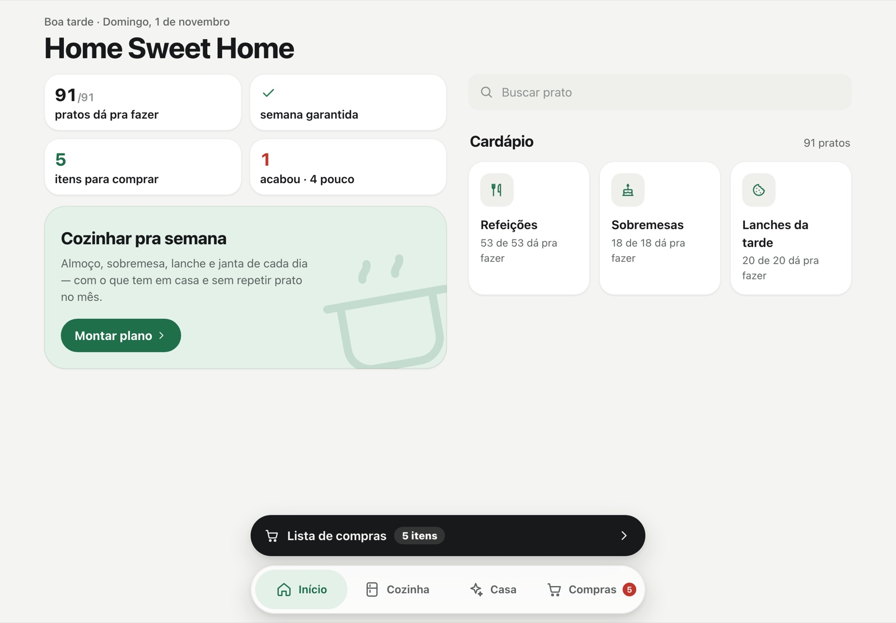
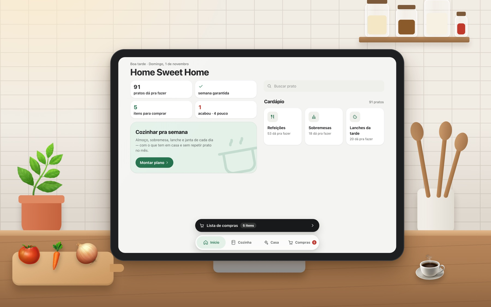

# Home Sweet Home 🏡

[English](README.md) · **Português**

Assistente de cozinha e casa, open source e para rodar no seu próprio computador. Marque o
que tem em casa, planeje a comida da semana com isso e transforme o que falta em lista de
compras.

[](LICENSE)




Pensado para ficar aberto num tablet na cozinha. Funciona também no celular e no computador
(2 colunas em telas largas) e pode ser instalado como app pelo navegador. Os pratos que vêm
com o app são comida de casa, brasileira e simples.

> Projeto pessoal feito no vibe coding, aberto para qualquer pessoa usar, adaptar e
> acrescentar suas próprias receitas.

## O que faz

- **Estoque da cozinha e da casa.** Itens por nome genérico ("Arroz", "Leite", não a marca)
  com três estados: *Tem*, *Pouco*, *Acabou*. Comida, limpeza, utensílios e higiene.
- **O que dá pra fazer?** Mostra quais pratos dá para fazer com o que tem.
- **Cozinhar pra semana.** Você escolhe quantos dias e sobremesas; o app escolhe os pratos,
  distribui almoço, sobremesa, lanche e janta, e monta o roteiro do dia de cozinha com
  horários.
- **Lista de compras.** Uma lista só, por categoria. **Enviar lista** compartilha (WhatsApp ou
  outro app) e **Comprei** devolve tudo ao estoque.
- **Alerta da semana.** Avisa o que falta para ter uma semana de comida.
- **Variedade.** Nenhuma refeição ou sobremesa se repete no mês.

## Como usar

Deixe aberto num tablet na bancada: dá para conferir o dia, marcar o que acabou e montar a
lista sem sair da cozinha.



| Aba | O que faz |
|---|---|
| 🏠 **Início** | Números do dia (pratos possíveis, semana garantida, itens para comprar, o que acabou), alerta da semana, card **Hoje** (almoço, sobremesa, lanche, janta e o que tirar do freezer) e o cardápio. |
| 🧺 **Cozinha** | Chips **acabou · pouco · na lista** que filtram a grade; categorias em blocos. Um toque no item passa de *Tem* para *Pouco* e para *Acabou*; o lápis edita. |
| 🧽 **Casa** | O mesmo para limpeza, utensílios e higiene. |
| 🛒 **Compras** | A lista de compras e **Comprados recentemente**, para pôr de volta com um toque. |

**Remover itens** só exclui itens que você adicionou. Os que vêm com o app não podem ser
excluídos nem renomeados.

## Rodar

Precisa só de Python 3 (o SQLite já vem junto).

```bash
git clone https://github.com/hi-mundo/HomeSweetHome.git
cd HomeSweetHome
python3 server.py
```

Abra `http://localhost:8080`. No celular ou tablet, na mesma rede Wi-Fi, abra
`http://<ip-deste-computador>:8080` e use **Adicionar à tela de início**.

| Variável | Padrão |
|---|---|
| `PORT` | `8080` |
| `LAR_DB` | `data/lar.db` (criado na primeira vez com itens comuns) |

Para deixar rodando sempre (Raspberry Pi, servidor em casa) com systemd ou nginx, veja
[DEPLOY.pt-BR.md](DEPLOY.pt-BR.md).

## Seus próprios pratos

Tudo o que o app sabe sobre comida fica em JSON na pasta [`pratos/`](pratos/): catálogo de
itens, panelas (preparos base) e pratos. O app relê a pasta sozinho, sem reiniciar, e mostra
erros de formato na tela Início. Formato em [`pratos/LEIA-ME.md`](pratos/LEIA-ME.md).

Dica: pratos novos que reaproveitam panelas que já existem deixam a semana com menos
trabalho.

## Como o planejador funciona

Algoritmo em [`cardapio.py`](cardapio.py), testes em [`test_cardapio.py`](test_cardapio.py).

<details>
<summary>Detalhes</summary>

1. **Escolhe os pratos.** Pré-seleciona os ~18 mais promissores e testa todas as combinações
   (menor é melhor): ingredientes que faltam, panelas diferentes, falhas de dieta, proteína
   repetida (no máx. 2 do mesmo tipo em 5 dias), horas de trabalho, perecíveis que não
   congelam e repetição no último mês.
2. **Distribui nos dias.** Cada prato vira um almoço e uma janta em dias diferentes. O que
   estraga antes vai para o começo; marmita que passaria da validade vai para o freezer, com
   lembrete de descongelar na véspera.
3. **Verduras.** Prato sem verdura ganha uma que ainda esteja na validade naquele dia.
4. **Reforço.** Marmita abaixo de 550 kcal ganha um extra que dura (farofa ou ovo cozido).
5. **Sobremesas e lanches.** Até 2 tipos de sobremesa; 1 lanche por dia, perecíveis primeiro.
6. **Roteiro do dia de cozinha.** Começa pelo que demora sozinho (pressão, forno), respeitando
   uma panela de pressão e o forno para 2 assadeiras.
7. **Checklist.** Proteína, carboidrato, proteínas variadas, verdura em todo prato,
   leguminosa, frutas e "nada passa da validade".

</details>

## Testes

```bash
python3 -m unittest test_cardapio.py
```

## Segurança

Não tem login: qualquer pessoa na sua rede consegue abrir. Use só na rede de casa e **não
exponha a porta para a internet**.

## Contribuir

Receitas, traduções e correções são bem-vindas. Veja [CONTRIBUTING.md](CONTRIBUTING.md).

## Licença

[MIT](LICENSE)
